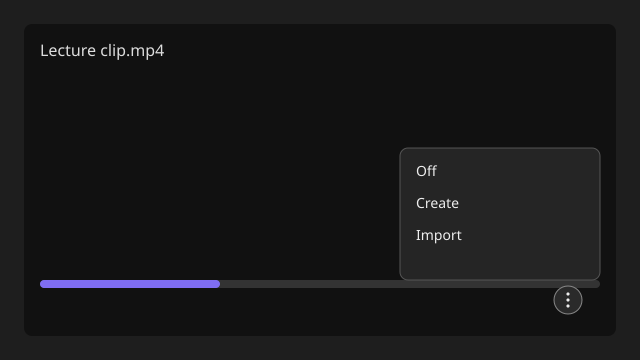

# Welcome to Video Subtitles!

## What Video Subtitles Does

While a vault video is playing, the player more-options control (three dots next to Download / Playback speed / Picture in picture) includes subtitle rows. Create transcribes the open video on desktop and stores an embedded generated track. Import picks an `.srt` or `.vtt` file. The plugin writes that track into the video file, so reopening the video restores the menu without a sidecar.

**Off** hides captions. It does not delete the stored track. Settings keep the downloaded transcriber by default so Create does not fetch it every time. You can change Whisper accuracy, language, translate to English, word timestamps, and diarization. Turn on **Choose Create range** to pick a start and end time when you press Create; off by default transcribes the whole video. **Process all videos** transcribes every vault video from settings. Overall and current-video progress update under that setting and stay on the workspace if you close settings. While that runs, Create on a queued video moves it to the front. The first desktop start picks an accuracy from this computer.

- Open a video, click the player more-options 3-dot, then choose **Off**, **Create**, or **Import**.
- Open more options again: the track name is listed. Select it to show captions on the video.
- Captions overlay in this app. Other apps will not show this stored track.
- Create downloads a local transcriber (Whisper + optional ffmpeg) into the plugin folder, then deletes it after use unless **Keep transcriber** is on. If Create stops early, finished windows are already stored as **generated**. Create again on the same video continues from there unless the file, range, or transcriber settings changed.
- Disable the plugin to return to the native player. Turning it off or uninstalling also deletes the downloaded Whisper transcriber.

## Setup

### Quick Start

1. Copy `main.js`, `manifest.json`, and `styles.css` into `.obsidian/plugins/video-subtitles/`.
2. Enable **Video Subtitles** in **Settings → Community plugins**.
3. Open a vault video and use the player more-options menu.

### Manual Setup

1. Clone this repository into `.Projects/video-subtitles`.
2. Run `npm install`, `npm test`, and `npm run build`.
3. The build copies `main.js`, `manifest.json`, and `styles.css` to `.obsidian/plugins/video-subtitles/`.
4. Reload the app and enable **Video Subtitles**.

## License

MIT — see [LICENSE](LICENSE).

## Compatibility

Works with vault video files: `mp4`, `webm`, `ogv`, `mov`, `mkv`.
